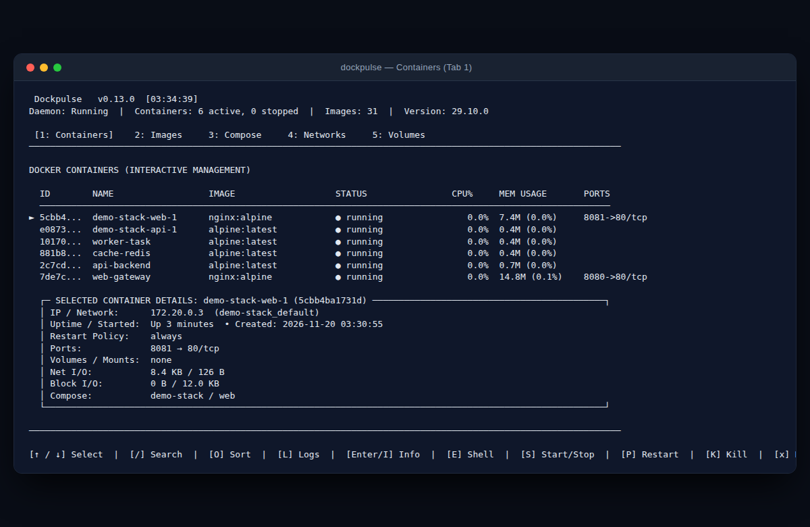

<div align="center">

# container-ctl

[](https://github.com/AndreyJVM/container-ctl/actions/workflows/ci.yml)
[](https://github.com/AndreyJVM/container-ctl/actions/workflows/codeql.yml)
[](https://github.com/AndreyJVM/container-ctl/releases)
[](https://golang.org)
[](https://goreportcard.com/report/github.com/AndreyJVM/container-ctl)
[](LICENSE)
[](https://github.com/AndreyJVM/container-ctl/releases)

**A fast, lightweight terminal TUI for Docker containers and resources.**<br>

[Key Features](#key-features) • [Installation](#installation) • [CLI Options](#command-line-options) • [Hotkeys](#hotkeys) • [Screenshots](docs/screenshots/) • [Contributing](CONTRIBUTING.md)

---

<p align="center">
  
</p>

</div>

### Key Features

- **Docker Containers**:
  - Live CPU% and memory stats with dynamic color coding.
  - Interactive sorting by CPU%, RAM, Name, or Status (`s`, `o`).
  - Live Network I/O (RX/TX) and Block I/O (Read/Write) metrics in details panel and inspect modal.
  - Healthcheck statuses (`[healthy]`, `[unhealthy]`, `[starting]`).
  - Search & filter by name, image, ID, or health status (`/`).
  - Logs viewer with scroll support (`L`).
  - Detailed container inspection modal (`Enter` / `I`).
  - Embedded interactive terminal (`E` — `/bin/bash` or `/bin/sh`) without leaving container-ctl, plus a full-screen fallback.
  - Power control: Start / Stop (`S`), Restart (`P`), Force Kill (`K` — `SIGKILL`).
  - Safe container removal with confirmation (`x`, `d`).
  - Docker System Prune modal (`C`) with disk reclaim estimates and confirmation.
  - Socket support: Docker daemon, Rootless Docker, and Rootless Podman (<2 ms latency) with automatic discovery across `XDG_RUNTIME_DIR`, `/run/user/$UID`, and candidate sockets.
- **Docker Images**:
  - Local image inventory with Image ID, Repository, Tag, Size, Created timestamp, and Digest.
  - Status indicators: `[In Use]`, `[Unused]`, and `[Dangling]` (`<none>:<none>`).
  - Search & filter by repository, tag, ID, or digest (`/`).
  - Selected image details panel (full ID, digest, all tags, container usage count).
  - Safe image removal with confirmation (`x`, `d`), including warning for in-use images.
- **Docker Compose**: Automatic project/service grouping, aggregated stack health, live stack logs (`L`), service control (`U` / `S` / `P`), and stack teardown (`D` / down) with confirmation.
- **Docker Networks**: Network driver, scope, connected container count, subnet, gateway, and Compose ownership.
- **Docker Volumes**: Volume driver, scope, reference count, disk usage, mountpoint, and Compose ownership.
- **Docker Swarm**: Cluster node roles (Leader, Manager, Worker), service listings, replica counts with degradation highlights, and live service logs (`L`). Dynamically shown when Swarm is active on the daemon (or forced with `--show-swarm`).
- **Modular Architecture ("Constructor")**: Pluggable subsystem registry. Administrators can tailor the dashboard by enabling only necessary tabs, reordering them, or assigning custom tab labels in `config.yaml`.
- **English Interface**: Consistent English UI, CLI help, diagnostics, and documentation.
- **Zero Dependencies**: Standalone binary (<12 MB) with zero external runtime dependencies. Runs on Linux, macOS, and FreeBSD.

### Installation

#### Go Install

Install the latest release directly via the Go toolchain (requires Go 1.24+):

```bash
go install github.com/AndreyJVM/container-ctl/cmd/container-ctl@latest
```

#### Linux Packages (.deb / .rpm / .apk)

Pre-built packages for **amd64** and **arm64** are available on the [Releases](https://github.com/AndreyJVM/container-ctl/releases) page:

```bash
# Debian / Ubuntu / Linux Mint (.deb)
sudo dpkg -i container-ctl_0.18.1_amd64.deb

# RHEL / Fedora / Rocky Linux (.rpm)
sudo rpm -i container-ctl_0.18.1_amd64.rpm

# Alpine Linux (.apk)
apk add --allow-untrusted container-ctl_0.18.1_amd64.apk
```

#### Pre-built Binaries (Linux, macOS, FreeBSD)

Download the archive for your operating system and architecture from [Releases](https://github.com/AndreyJVM/container-ctl/releases):

```bash
# Example: Linux AMD64
tar -xzf container-ctl_0.18.1_linux_amd64.tar.gz
./container-ctl
```

#### Build from Source

```bash
git clone https://github.com/AndreyJVM/container-ctl.git
cd container-ctl
make build
./container-ctl
```

### Command-line Options

```text
Usage:
  container-ctl [options]

Options:
  -c, --config <path>        Path to YAML config file (default: ~/.config/container-ctl/config.yaml)
  -i, --interval <duration>  Auto-refresh interval (default: 2s, env: DOCKPULSE_INTERVAL)
  -t, --tab <1-6|name>       Initial active tab (1: Docker, 2: Images, 3: Compose, 4: Networks, 5: Volumes, 6: Swarm) (default: 1, env: DOCKPULSE_TAB)
      --show-swarm           Always display Swarm tab even if inactive (env: DOCKPULSE_SHOW_SWARM)
      --init-config          Generate a sample config file in ~/.config/container-ctl/config.yaml
      --print-config         Print active configuration and exit
  -v, --version              Show version information
  -h, --help                 Show help message
```

### Configuration File (`config.yaml`)

container-ctl automatically detects and loads a configuration file from standard locations:
- `$XDG_CONFIG_HOME/container-ctl/config.yaml` or `~/.config/container-ctl/config.yaml`
- `~/.container-ctl.yaml`
- `./container-ctl.yaml` (local workspace override)
- Or explicitly via `--config <path>`

Generate a starter configuration file:
```bash
container-ctl --init-config
```

Inspect the currently active configuration:
```bash
container-ctl --print-config
```

Example `config.yaml`:
```yaml
# Metrics auto-refresh interval (for example: 1s, 2s, 500ms)
interval: 2s

# Initial active tab: 1|docker, 2|images, 3|compose, 4|networks, 5|volumes, 6|swarm
initial_tab: docker

# Always display the Swarm tab even if cluster is inactive
show_swarm: false

# Docker connection settings
docker:
  # Optional custom Unix socket path override (leave empty for auto-detection)
  # socket_path: /var/run/docker.sock
  socket_path: ""

# User interface preferences
ui:
  # Filter images tab to only unreferenced/dangling images by default
  only_unused_images: false

  # Default container sort mode: default, cpu, mem, name, status
  default_sort: default

# Optional module constructor configuration (customize enabled tabs, custom ordering, and titles)
# modules:
#   containers:
#     enabled: true
#   images:
#     enabled: true
#   compose:
#     enabled: true
#   networks:
#     enabled: true
#   volumes:
#     enabled: true
#   swarm:
#     enabled: auto # auto: shown when active or show_swarm is true; true: force show; false: disable
```

#### Modular Constructor Setup

container-ctl can be tailored specifically to your server requirements. You can selectively enable or disable modules, change tab display order, or assign custom titles:

| Module ID | Description | Default State |
|---|---|---|
| `containers` | Container metrics, health, power controls, and embedded terminal | Enabled (`order: 1`) |
| `images` | Image inventory, sizes, digests, and disk cleanup | Enabled (`order: 2`) |
| `compose` | Docker Compose stack management and grouped logs | Enabled (`order: 3`) |
| `networks` | Network inspect, subnets, and connected endpoints | Enabled (`order: 4`) |
| `volumes` | Storage volumes and disk usage metrics | Enabled (`order: 5`) |
| `swarm` | Docker Swarm cluster topology, nodes, and replicas | Auto-detected (`order: 6`) |

**Example:** production server setup focusing only on containers and Swarm cluster (disabling unused monitors to minimize API calls):
```yaml
modules:
  containers:
    enabled: true
    title: "Services"
    order: 1
  swarm:
    enabled: true
    title: "Cluster"
    order: 2
  images:
    enabled: false
  networks:
    enabled: false
  volumes:
    enabled: false
  compose:
    enabled: false
```


### Hotkeys

| Key | Action |
|---|---|
| `1`..`9` / `Tab` / `Shift+Tab` / `←`/`→` | Switch tabs dynamically based on configured visible modules |
| `r`, `R` | Force immediate refresh |
| `↑` / `↓` (or `k` / `j`) | Navigate rows / select items |
| `/` | Search & filter in list or in log viewer modal (`Esc` to clear) |
| `o`, `O` | Cycle container sort mode (CPU, Memory, Name, Status) |
| `w`, `W` | Open container localhost URL in browser / copy to clipboard |
| `y`, `Y` | Copy `docker exec -it <name> sh` or ID to clipboard via terminal OSC 52 |
| `L` | View logs (regex search with `/`, syntax highlighting, scroll with `↑`/`↓`/`PgUp`/`PgDn`) |
| `Enter` / `I` | Inspect container (details, mounts, network, ports, health, masked env vars) |
| `E` | Open or focus the embedded container terminal (`/bin/bash` or `/bin/sh`) |
| `Ctrl+]` | Return focus from the embedded terminal to container-ctl |
| `Ctrl+D` | Exit the current shell session while the terminal is focused |
| `Ctrl+X` | Close an unfocused embedded terminal |
| `s`, `S` | Start / Stop container or Compose stack; Scale service replicas (on Swarm tab) |
| `+`, `-` | Quick increase / decrease service replicas (+1 / -1 on Swarm tab) |
| `P` | Restart container or Compose stack |
| `K` | Force kill (`SIGKILL`) container |
| `x`, `d` | Remove container or image (with confirmation) |
| `u`, `U` | Toggle unused images filter (on Images tab), or Start Compose stack (on Compose tab) |
| `D` | Compose down (`docker compose down`) with confirmation |
| `C` | Docker system prune (cleanup unused resources) |
| `?` | Toggle help / hotkey shortcuts modal |
| `q` / `Esc` / `Ctrl+C` | Quit application |

### Community & Governance

- **Contributing**: Please review [CONTRIBUTING.md](CONTRIBUTING.md) for development workflow, architectural guidelines, and test instructions.
- **Code of Conduct**: We follow the [Contributor Covenant](CODE_OF_CONDUCT.md) to ensure an open and welcoming community.
- **Security Policy**: Read [SECURITY.md](SECURITY.md) for instructions on reporting vulnerabilities responsibly.
- **License**: container-ctl is released under the [MIT License](LICENSE).

---

### Dashboard Views

| Tab | View | Description |
|:---:|---|---|
| `1` | **Docker** | Live container stats, CPU & RAM bars, health badges, ports, and embedded shell (`E`) |
| `2` | **Images** | Local image inventory, digest, tags, sizes, usage status, and image pruning |
| `3` | **Compose** | Service orchestration grouping, live project logs (`L`), and stack control (`U`/`S`/`D`) |
| `4` | **Networks** | Network drivers, IPAM subnets, gateways, and attached container list |
| `5` | **Volumes** | Volume drivers, disk usage, mount points, and container references |
| `6` | **Swarm** *(adaptive)* | Cluster node inventory, roles, service replica distribution, interactive scaling (`s`, `+`/`-`), and task logs |

> Detailed screenshots and visual guides are available in [docs/screenshots/](docs/screenshots/).

