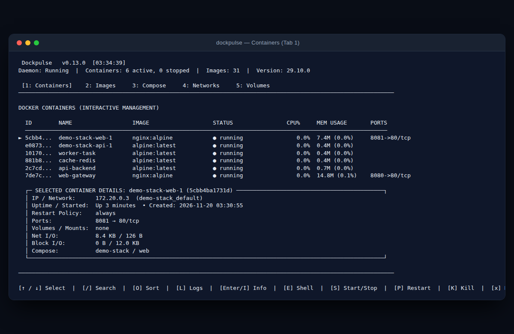
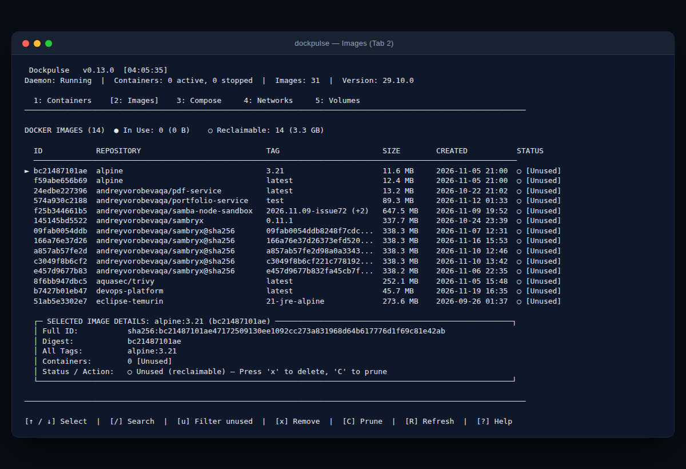
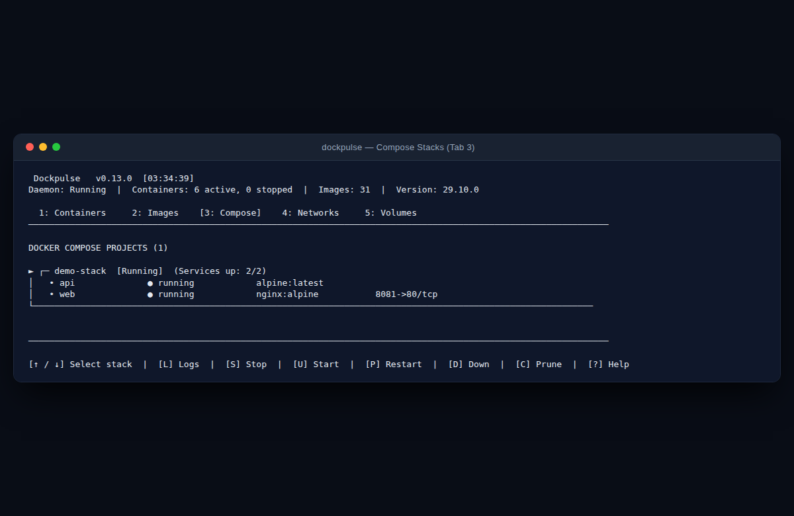
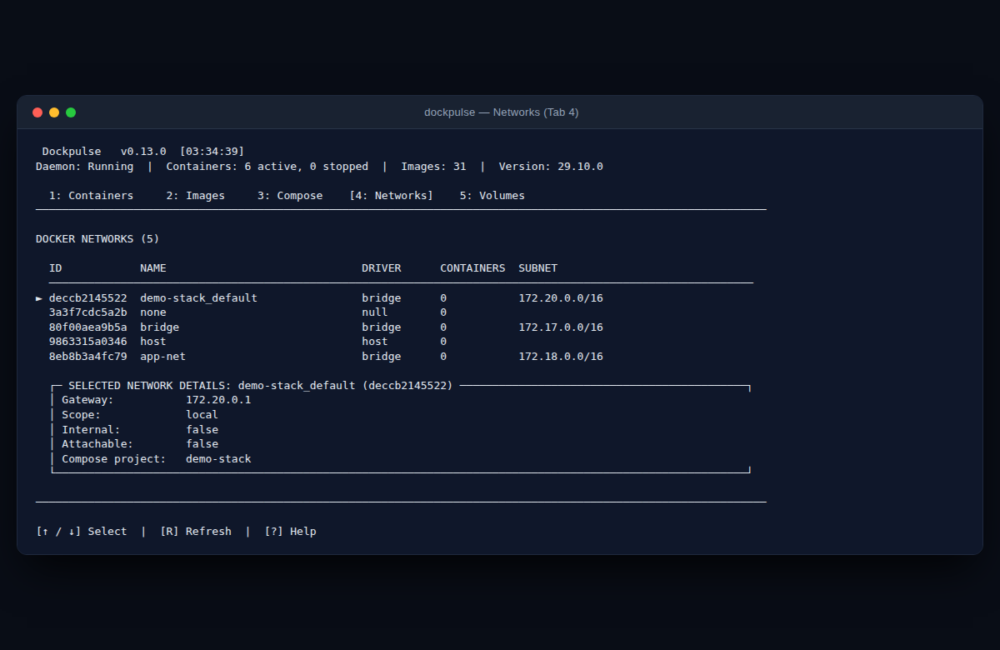
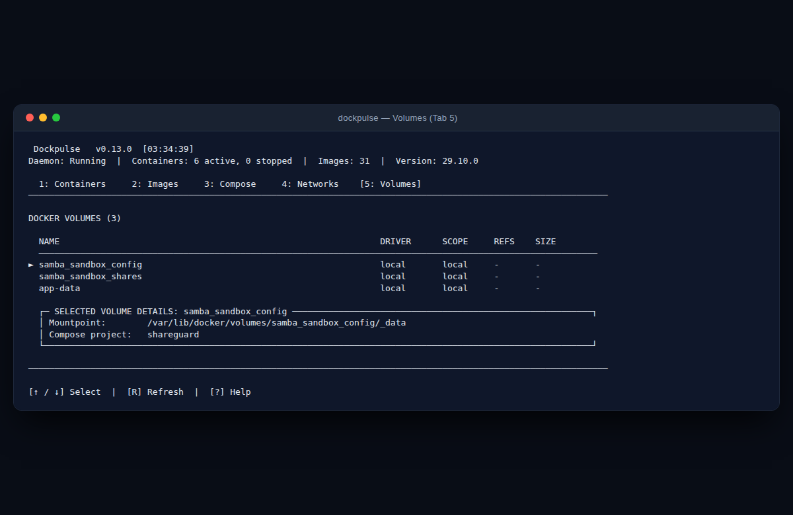
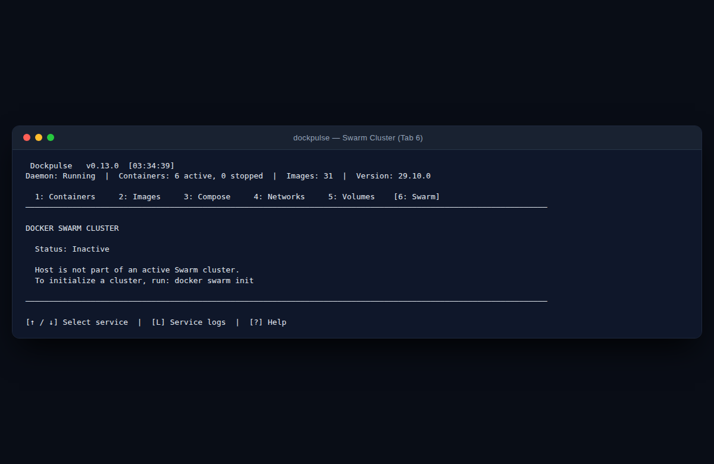
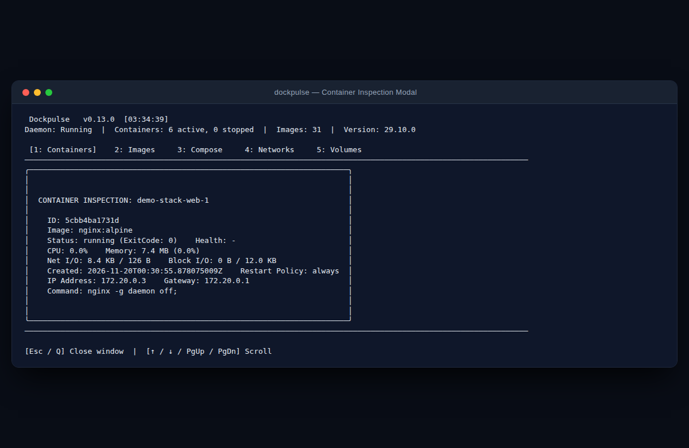
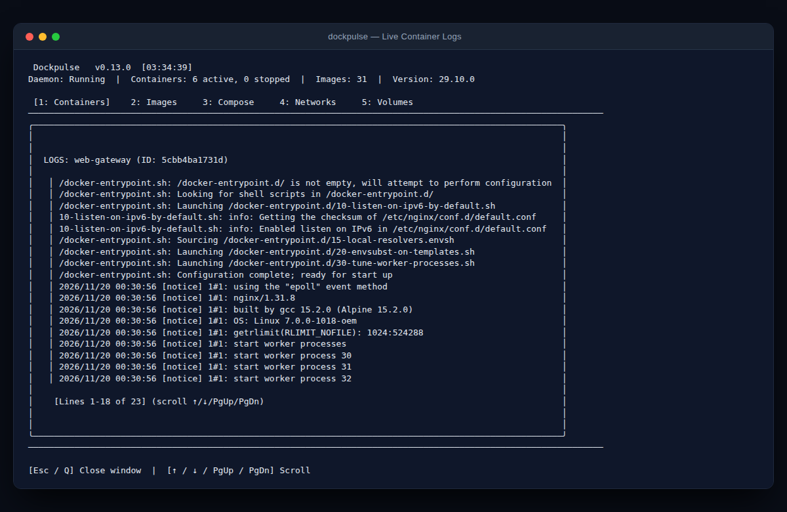

# container-ctl Screenshots & Visual Guide

A gallery of the container-ctl terminal user interface across all dashboard tabs and management modals.

---

### Tab 1: Docker Containers
Interactive container management, live CPU & RAM usage, health badges, ports, and container details card.

---

### Tab 2: Docker Images
Local image inventory with image ID, repository, tag, size, status (`[In Use]` / `[Unused]`), and details panel.

---

### Tab 3: Docker Compose
Service orchestration grouping, aggregated stack status, live stack logs (`L`), and stack control (`U` / `S` / `D`).

---

### Tab 4: Docker Networks
Network driver inventory, IPAM subnet and gateway definitions, scopes, and attached containers.

---

### Tab 5: Docker Volumes
Volume inventory, volume driver types, scope, mountpoints, and Compose project attachments.

---

### Tab 6: Docker Swarm *(Adaptive)*
Cluster status, node inventory, manager/worker distribution, service replica state, and cluster logs.

---

### Modal: Container Inspection
Deep container inspection modal showing runtime metadata, IP addresses, restart policy, and health status.

---

### Modal: Live Container Logs
Scrollable real-time container log viewer with navigation shortcuts (`↑`, `↓`, `PgUp`, `PgDn`).

